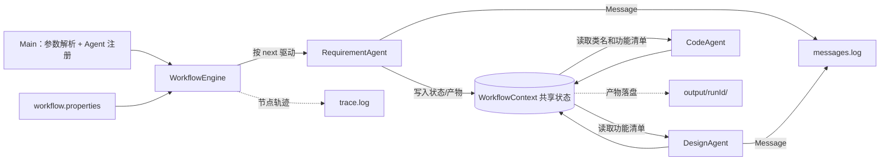
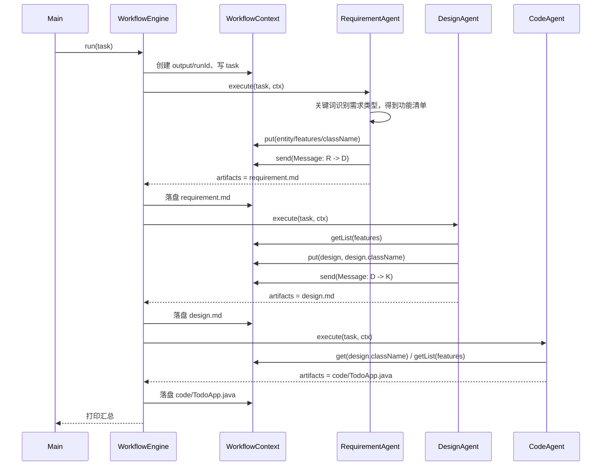

# 设计文档（Design.md）

## 1. 目标与范围

本项目的目标是做一个**能跑通的多 Agent 协作 Workflow MVP**，重点不在业务复杂度，而在于把三件事讲清楚：

1. **编排**：谁先执行、谁后执行、下一步是谁；
2. **通信**：Agent 之间怎么传数据、怎么知道对方做完了；
3. **状态**：中间产物放在哪、下游怎么拿到。

业务流程选择 Mini SE 流程：

> **需求 Agent → 设计 Agent → 编码 Agent**

每个 Agent 都是**职责单一、可以被引擎独立调度的组件**，彼此之间不直接调用，
只通过共享状态和消息协作。

不在范围内：持久化、分布式调度、可视化编排界面、并行执行。

---

## 2. 总体架构



分层职责：

| 层 | 类 | 职责 | 变化频率 |
|---|---|---|---|
| 入口层 | `Main` | 解析参数、**注册 Agent** | 低（加 Agent 时改一行） |
| 引擎层 | `WorkflowEngine` | 驱动节点、分支跳转、重试、日志 | **极低（几乎不改）** |
| 契约层 | `Agent` / `AgentResult` / `Message` | 定义 Agent 如何被调用、如何返回 | 极低 |
| 状态层 | `WorkflowContext` | 共享状态、产物落盘、消息日志 | 低 |
| 业务层 | `agents/*` | 每个节点具体做什么 | **高（主要扩展点）** |
| 数据结构层 | `FeatureSpec` | 三个 Agent 之间传递的功能项 | 低 |

---

## 3. 核心机制

### 3.1 编排：配置驱动

流程不写死在代码里，而是从 `workflow.properties` 读取，形成 `Map<节点ID, Node(id, agent, next)>`。

引擎主循环：

```text
current = entry
while current != null and steps < maxSteps:
    node   = config.node(current)
    agent  = registry.get(node.agent)
    result = agent.execute(task, ctx)
    保存 result.artifacts
    current = result.next != null ? result.next : node.next
    steps++
```

- **静态跳转**：`node.next` 决定默认顺序；
- **动态跳转**：`AgentResult.next` 非空时覆盖默认顺序。当前三个 Agent 都返回 `null`，
  该能力保留给后续需要条件分支的场景（例如新增一个检查节点，不通过则退回上一步）；
- **防失控**：`maxSteps` 是硬上限，配置错误导致环状跳转时也会强制结束。

### 3.2 通信：两条通道

| 通道 | 载体 | 用途 | 证据 |
|---|---|---|---|
| 状态共享（隐式） | `WorkflowContext` 的 `state` Map | 上游放功能清单，下游直接读取 | 代码 `ctx.put` / `ctx.getList` |
| 消息传递（显式） | `Message` 记录 | 通知下游「我做完什么了」 | 控制台 + `messages.log` |

设计上两者并存：**数据走状态，事件走消息**。
只做状态共享会让「协作」不可见；只做消息又会让大数据传递变得笨重。

`Message.type` 的取值：

- `HANDOFF`：上游把产物交给下游；
- `DONE`：流程结束，通知用户。

### 3.3 状态：共享黑板

`WorkflowContext` 是运行期的公共数据区，包含：

- `state: Map<String, Object>`：键值状态；
- `outputDir`：本次运行的产物目录 `output/{runId}/`；
- `messages`：本次运行的所有消息；
- 两个日志 Writer：`messages.log`、`trace.log`。

状态键约定：

| Key | 写入者 | 读取者 | 类型 |
|---|---|---|---|
| `task` | 引擎 | 所有 Agent | String |
| `domain` | RequirementAgent | 人工查看 | String |
| `entity` | RequirementAgent | DesignAgent、CodeAgent | String |
| `updateSuffix` | RequirementAgent | CodeAgent | String |
| `className` | RequirementAgent | DesignAgent | String |
| `features` | RequirementAgent | DesignAgent、CodeAgent | `List<FeatureSpec>` |
| `design` | DesignAgent | CodeAgent（记录用） | String |
| `design.className` | DesignAgent | **CodeAgent（取类名）** | String |
| `code` | CodeAgent | 后续可扩展的测试 Agent | String |

**依赖关系是显式的**：编码 Agent 使用的类名来自设计 Agent 写回的 `design.className`，
如果设计节点没执行，编码节点会直接报错并提示检查流程顺序。

### 3.4 一次完整执行的时序



### 3.5 容错

| 场景 | 处理 |
|---|---|
| 节点抛异常 | 引擎重试 `maxRetries` 次，等待 500ms、1000ms… |
| 超过重试次数 | 流程终止，打印可读错误信息 |
| 上游状态缺失 | Agent 主动抛出带提示的异常（例如“需求节点必须在设计节点之前”） |
| 配置引用了不存在的 Agent / 节点 | 引擎/配置加载阶段直接报错并指出名字 |
| 运行目录重名 | 自动追加后缀，绝不覆盖上一次的产物 |

### 3.6 可观测性

- **控制台**：每一步的节点、Agent、产物、耗时、消息；
- **`trace.log`**：`步骤 节点 Agent 耗时 结果 下一步`；
- **`messages.log`**：消息时间线，直接体现 Agent 间通信；
- **产物目录**：每个 Agent 的输出都是可打开、可验证的文件。

---

## 4. 关键设计取舍

| 决策 | 选择 | 理由 |
|---|---|---|
| 是否用框架（Spring / 工作流引擎） | 不用，手写引擎 | 作业考察的是「理解编排、通信、状态」；手写才能讲清楚每一行 |
| 是否引入第三方库 | 不引入 | 零依赖 = 任何装了 JDK 的机器都能编译；构建也更快 |
| 流程写死还是配置化 | 配置化 | 直接对应「可扩展性」评分项 |
| Agent 之间直接调用还是由引擎调度 | **引擎调度** | Agent 之间解耦，任何一个都能单独替换或删除 |
| 数据传参用方法参数还是共享状态 | 共享状态 | 新增 Agent 时不需要修改已有 Agent 的签名 |
| 生成的代码覆盖哪些业务 | 待办 / 图书 / 成绩 / 通用四类 | 通过关键词识别，保证演示时能体现“输入不同、产物不同” |

---

## 5. 扩展性验证

新增一个 Agent 的完整改动面：

1. `agents/XxxAgent.java` —— 新增一个类；
2. `Main.java` —— 新增一行注册；
3. `workflow.properties` —— 新增一个节点、改一个 `next`。

**引擎、状态、日志、消息、重试逻辑全部无需改动。**

如果后续需要条件分支（例如加入一个检查节点，不通过则退回上一步），也不需要改引擎：
让该 Agent 返回 `AgentResult.branch(..., "design")` 即可，引擎已经支持动态跳转，
并且有 `maxSteps` 防止无限循环。

---

## 6. 局限与后续演进

- **无持久化**：状态只在内存中，进程退出即丢失。可加 JSON 快照。
- **无并行**：目前单线程顺序执行。可在引擎中接入 `ExecutorService` 支持 fan-out / fan-in。
- **生成代码较固定**：编码 Agent 按功能类型套用模板，适合演示，不适合生成复杂业务。
- **无人工审批节点**：可加一个等待控制台输入的 Agent，在关键节点暂停。
